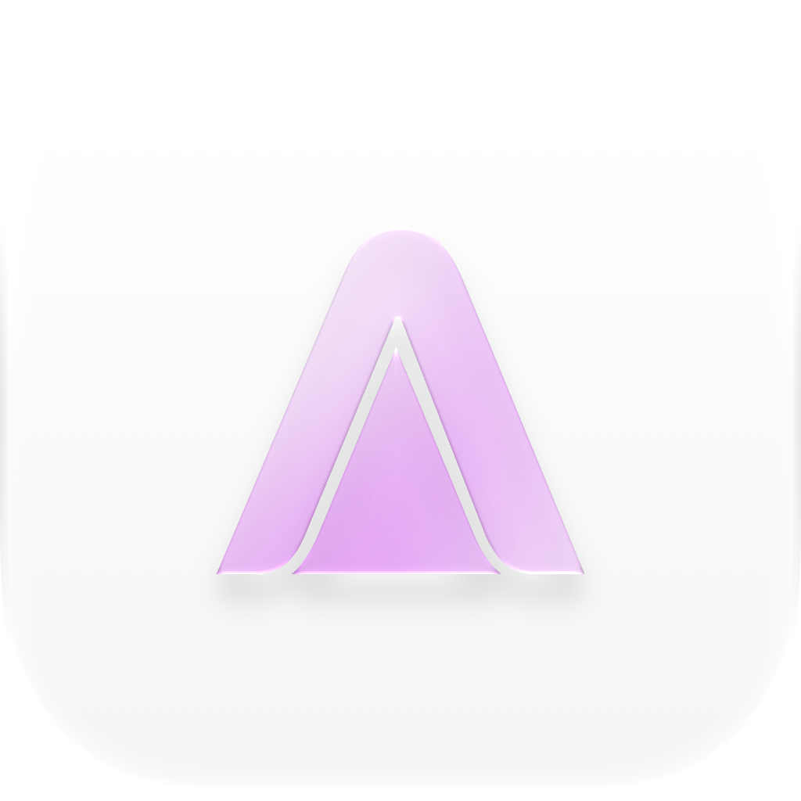

# Altar

<p align="center">
  
</p>

<p align="center"><strong>Windows 开发环境管理器</strong><br>发现、安装、切换并维护常用开发工具。</p>

<p align="center">
  <a href="https://github.com/ransen1337-star/altar-software">GitHub</a>
  · <a href="../git-mirror/README.md">Git 镜像</a>
  · <a href="LICENSE">AGPL-3.0</a>
</p>

## 概览

Altar 将 Windows 上分散的开发环境集中到一个桌面工作台。它提供版本发现、安装任务、路径管理和镜像源配置，适合需要在多台机器上保持工具链一致的开发者。

| 能力 | 说明 |
| --- | --- |
| 环境管理 | Python、Node.js、JDK、Go、Rust、.NET SDK、C/C++、PHP、Ruby、Dart、R、Julia、Perl、Lua、Kotlin、Scala |
| 安装任务 | 并行队列、暂停、恢复、取消、断点续传和分段下载 |
| 版本维护 | 已安装环境扫描、版本并存、切换、更新和卸载 |
| 下载来源 | 官方源、地区备用源和可配置的 GitHub 镜像 |
| 日志 | 下载页提供错误、标准和详细级别 |

## 技术栈

- Electron 主进程与 Windows 平台层
- React、TypeScript、Vite 渲染界面
- Node.js 下载器与 SHA-256/SHA-512 完整性校验

## 开发

```powershell
npm install
npm run dev
```

`npm run dev` 会同时启动 Vite 和 Electron。只运行浏览器界面时使用 `npm run dev:web`。

## 校验

```powershell
npm test
npm run build
```

## 镜像同步

镜像同步脚本根据官方发布元数据生成版本清单，比较版本、文件名和哈希后下载新增内容。镜像仓库的工作流位于同级 [`../git-mirror/`](../git-mirror/)，软件也可以在设置页配置镜像 raw 地址。

本地同步示例：

```powershell
node scripts/update-mirror.mjs --mirror-dir D:\repos\altar-git-mirror --push
```

## 项目结构

```text
electron/       Electron 主进程、安装器、下载器和 Windows 平台层
src/            React 页面、组件、状态和样式
scripts/        开发启动、镜像同步和维护脚本
tests/          安装器、下载器和 Windows 平台测试
public/         浏览器和桌面端使用的品牌资源
```

## 许可证

本项目使用 GNU AGPL-3.0，详见 [LICENSE](LICENSE)。部分前端布局、暗色主题、控件和交互设计基于 Widdit 的 `now-playing-frontend` 固定版本改造，相关署名保留在此处。
